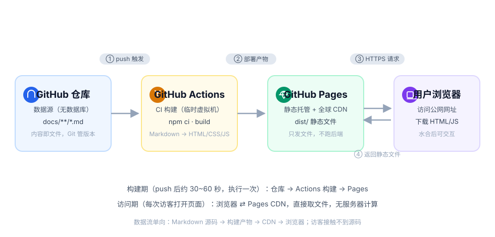
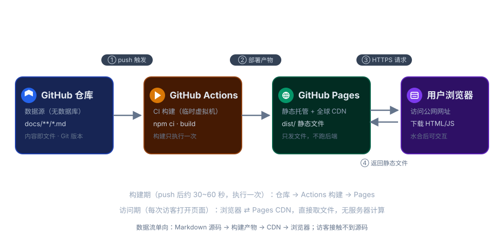

# 本站构建方法

本站基于 [VitePress](https://vitepress.dev/) 构建，源码托管在 GitHub 仓库 [RicardoWHao/learn-soft-engineering](https://github.com/RicardoWHao/learn-soft-engineering)，通过 GitHub Actions 自动部署到 GitHub Pages，无需购买服务器。

本文讲清楚这个网站从"写下一个 Markdown 文件"到"用户在公网打开页面"之间发生的全部事情：数据源是什么、页面如何渲染、GitHub Pages 到底是什么服务、自动部署能力由谁提供、以及它和开源 CI/CD（Jenkins、GitLab CI 等）是什么关系。

## 一、核心结论：这是一个"没有后端服务器"的网站

本站属于 **JAMStack / 静态站点（SSG，Static Site Generation）** 架构，由四部分组成：

| 角色 | 用的东西 | 说明 |
|------|----------|------|
| 数据源 | GitHub 仓库里的 `docs/**/*.md` | Markdown 文件就是全部内容，**没有数据库** |
| 构建器 | VitePress（Node.js 工具，开源） | 在"构建时"把 Markdown 编译成静态 HTML/CSS/JS |
| CI 流水线 | GitHub Actions（GitHub 提供的云服务） | 监听到 push 后，自动执行构建并发布 |
| 托管/服务器 | GitHub Pages（GitHub 提供的托管服务） | 全球 CDN，只负责把静态文件发给浏览器 |

与传统网站的区别：

| 对比项 | 传统动态网站（如 Java/PHP 网站） | 本站（静态站点） |
|--------|----------------------------------|------------------|
| 页面何时生成 | 用户每次请求时，服务器实时查库、套模板渲染 | **推送代码时预先构建好**，请求时直接取文件 |
| 后端服务器 | 需要 7×24 运行的应用服务器 | 不需要 |
| 数据库 | 需要（MySQL 等） | 不需要，Git 仓库承担版本化存储 |
| 访问速度 | 受服务器计算与数据库影响 | 文件走 CDN，极快 |
| 运维成本 | 买服务器、部署、运维、打安全补丁 | 零，GitHub 全托管且免费 |

## 二、整体架构总览

{.light-only}
{.dark-only}

数据流是**单向**的：`Markdown 源码 → 构建 → 静态产物 → CDN → 浏览器`。浏览器永远不会直接读取你的 GitHub 源码或 Markdown，它拿到的只是构建产物的一个"快照"。

- **构建期**：你 push 之后发生一次，在 GitHub Actions 的临时机器上完成，产出静态文件并发布。
- **访问期**：每个访客的浏览器与 GitHub Pages 的 CDN 之间只做文件传输，没有任何服务端计算。

## 三、GitHub Pages 到底是什么服务

GitHub Pages 是 **GitHub 官方提供的一项"静态网页托管服务"（Static Site Hosting）**，可以理解为"GitHub 送你的一个只能放静态文件的公网 Web 空间"。

### 它做什么

- 接收浏览器的 HTTP(S) 请求，把对应的 HTML/CSS/JS/图片文件返回出去——本质是一个挂在**全球 CDN**（底层主要由 Fastly 提供）上的静态文件服务器。
- 自动给你的站点签发和续期 **HTTPS 证书**，并支持绑定**自定义域名**。
- 公网默认给你一个免费二级域名，不需要买域名、不需要备案。

### 它不做什么（关键边界）

- **不能运行任何服务端代码**：Java、PHP、Node.js、Python 都跑不了，也连不上数据库。它不是云主机，没有"后端进程"的概念。
- 这正是本站选择静态架构的原因——页面在推送时就已经构建成纯文件，访问时本来就不需要计算，所以 Pages"只能发文件"的限制完全不构成问题。

### 两种站点形式

| 类型 | URL 形式 | 对应设置 |
|------|----------|----------|
| 用户/组织站点 | `用户名.github.io/` | 仓库名必须叫 `用户名.github.io`，部署在根路径 |
| 项目站点（本站属于这种） | `用户名.github.io/仓库名/` | 任意仓库都可以，部署在子路径，所以配置里需要 `base: '/learn-soft-engineering/'` |

### 免费额度（公开仓库）

- 公开仓库使用 Pages 免费，站点存储上限约 1 GB、软限制月流量约 100 GB——对个人知识站点绰绰有余。
- 构建不占用旧版 Pages 的构建配额：本站的构建是在 **GitHub Actions** 里完成的（公开仓库 Actions 分钟数免费），Pages 只负责接收最终产物。

### GitHub 三件套的分工

可以把整个方案理解为 GitHub 三个产品的组合：**仓库**负责存源码（Git 托管）、**Actions** 负责算（构建）、**Pages** 负责发（对外提供访问）。三者都在 GitHub 内部打通，所以不需要任何第三方服务器。

## 四、数据源：GitHub 仓库即数据库

- **唯一事实来源（Single Source of Truth）**是仓库 `docs/` 目录下的 Markdown 文件。
- 改内容 = 改文件；发版 = 提交（commit）；历史版本 = Git 提交历史。Git 天然替代了数据库的"增删改查 + 版本回溯"能力。
- 站点结构（顶部导航、侧边栏、标题、搜索开关）不是写死在页面里的，而是声明在配置文件 `docs/.vitepress/config.mts` 中。
- 内容与展示分离：你只管写 Markdown，页面框架、主题、响应式、深浅色模式都由 VitePress 统一负责。

## 五、一次页面访问的完整链路

以访问 `https://ricardowhao.github.io/learn-soft-engineering/middleware/web/tomcat` 为例：

1. **DNS 解析**：域名 `ricardowhao.github.io` 解析到 GitHub Pages 的边缘节点（CDN）。
2. **请求静态文件**：CDN 根据 URL 找到预先构建好的 `tomcat.html`，直接返回给浏览器，**全程没有任何应用服务器做计算**。
3. **加载资源**：浏览器解析 HTML，继续下载其中引用的 CSS 和 JS（路径都带 `/learn-soft-engineering/` 前缀，由 `base` 配置决定）。
4. **水合（Hydration）**：JS 执行，把静态 HTML"激活"为可交互的 Vue 应用——此时搜索框、深浅色切换、侧边栏展开才开始工作。
5. **站内跳转**：之后点击其他菜单，页面不再整刷，而是由前端路由（SPA 模式）直接拉取对应页面片段切换，体验接近 App。

**URL 与源文件的映射关系**（构建时一一对应生成）：

| 你写的源文件 | 构建产物 | 公网访问 URL |
|-------------|----------|--------------|
| `docs/index.md` | `index.html` | `/learn-soft-engineering/` |
| `docs/middleware/web/tomcat.md` | `middleware/web/tomcat.html` | `/learn-soft-engineering/middleware/web/tomcat` |
| `docs/about/index.md` | `about/index.html` | `/learn-soft-engineering/about/` |

## 六、页面是如何渲染的：构建时渲染（SSG）

关键在于区分"构建时"和"运行时"：

```text
构建时（GitHub Actions 上执行一次）
  Markdown(.md)
    → 解析为带 frontmatter 的组件
    → 每个 .md 编译成一个 Vue 单文件组件
    → Vite 打包、压缩
    → 用 Vue 的服务端渲染能力把每个页面"预渲染"成完整 HTML
    → 输出到 docs/.vitepress/dist/（纯静态文件）

运行时（每个访客浏览器里）
  下载预渲染 HTML（首屏秒开、对搜索引擎友好）
    → 加载同一份 JS
    → Hydration 水合，接管交互
    → 后续跳转走客户端路由
```

这种"先在构建期把页面算好"的方式带来三个直接好处：

- **首屏快**：HTML 里已经有完整内容，不需要等 JS 跑完再请求数据。
- **SEO 友好**：搜索引擎爬虫抓到的就是完整 HTML，而非空白壳。
- **可托管在任意静态服务**：因为产物就是文件，Nginx、对象存储、CDN 都能挂。

### 站内搜索为什么也不需要后端？

配置里的 `search: { provider: 'local' }` 会让 VitePress **在构建时扫描全部 Markdown，生成一份压缩的本地搜索索引（JSON）**。用户搜索时，浏览器内的 MiniSearch 引擎直接在这份索引里匹配，请求不出本机，因此没有搜索服务器。

## 七、前端代码写在哪里

```text
knowledge-site/
├── package.json              # 依赖与脚本（dev/build/preview 命令）
├── package-lock.json         # 依赖版本锁定，保证 CI 与本地一致
├── .github/workflows/
│   └── deploy.yml            # CI/CD 流水线定义（自动发布的"剧本"）
└── docs/                     # ★ 你日常只需要关心这个目录
    ├── index.md              # 首页（hero 布局写在 frontmatter 里）
    ├── .vitepress/
    │   └── config.mts        # ★ 站点配置：导航栏、侧边栏、搜索、base 路径
    ├── about/
    │   ├── index.md            # 本页
    │   ├── architecture-light.svg / architecture-dark.svg  # 架构图源文件
    ├── basics/  framework/  middleware/  database/ ……  # 各知识分区
    └── **/*.md               # 每一个 md 就是一个页面
```

注意：仓库里**没有** `src/`、`.vue`、`index.html`，这是 VitePress 项目的正常形态——每个 Markdown 文件在构建时被编译成 Vue 组件，页面框架代码是 VitePress 自带的（装在 `node_modules/`，不提交到 Git，由 `npm ci` 按 `package-lock.json` 还原）。

新增一个页面只需两步：

1. 在 `docs/` 下对应目录新建 `xxx.md` 并写内容；
2. 在 `config.mts` 的 `nav`（顶部菜单）和 `sidebar`（左侧栏）登记它的链接和标题。

如果 Markdown 表达不了，可以在 `docs/.vitepress/theme/` 下扩展自定义 Vue 组件与样式，但本站目前只使用纯 Markdown。

## 八、"前端"和"后端"分别部署在哪

### 前端：GitHub Pages

- 本质是**静态文件存储 + 全球 CDN**。构建产物 `dist/` 被上传后，GitHub 把它分发到边缘节点。
- 它只能托管静态文件，不能运行 Java/Node/PHP 这类服务端代码——但本站在运行时根本不需要这些。

### 后端：不存在

本站没有应用服务器，也没有数据库。传统网站里依赖后端的交互，在这里都被"构建期预处理"或"第三方 SaaS"替代：

| 传统上需要后端的功能 | 本站的替代方案 |
|----------------------|----------------|
| 内容存储与查询 | 构建期把 Markdown 固化进 HTML |
| 全文搜索 | 构建期生成索引，浏览器本地检索 |
| 评论（暂未开启） | 可接入 Giscus，数据存放在 GitHub Discussions |
| 访问统计（暂未开启） | 可接入不蒜子 / Google Analytics 等第三方脚本 |

如果未来确实需要真正的动态接口（例如用户登录、写数据库），才需要额外引入 Serverless 函数或独立后端——对于知识库类站点通常永远用不到。

## 九、自动发布：GitHub Actions 是什么，与开源 CI/CD 是什么关系

### 自动部署的能力是 GitHub 提供的吗

**是。** 这套自动构建、自动发布的能力来自 GitHub 官方的云服务 **GitHub Actions**；我们写的 [.github/workflows/deploy.yml](https://github.com/RicardoWHao/learn-soft-engineering/blob/main/.github/workflows/deploy.yml) 只是一份描述"该做什么"的流水线剧本（YAML），真正的执行机器、网络和发布通道都是 GitHub 提供的，公开仓库免费使用，并且用仓库自带的临时令牌鉴权，不需要配置任何密码。

### 先理解 CI/CD

- **CI（持续集成，Continuous Integration）**：代码一提交，就自动跑"拉代码 → 装依赖 → 构建 → 测试"，尽早发现问题。
- **CD（持续交付/部署，Continuous Delivery/Deployment）**：构建通过后自动发布，本站的场景是把静态文件部署到 Pages。
- 一份流水线通常包含：**触发器**（push 到 main）→ **运行环境（Runner，一台临时虚拟机）** → **若干 Job/Step**（检出代码、装 Node、`npm ci`、`vitepress build`、发布产物）。

### 与开源 CI/CD 产品的关系

GitHub Actions 不是唯一选择，它属于"**托管型 CI/CD 平台**"这一类产品；开源世界有一大批解决同样问题、核心概念完全相通的工具：

| 工具 | 开源情况 | 谁来维护运行机器 | 流水线文件 |
|------|----------|------------------|------------|
| **GitHub Actions** | 平台闭源、生态（Actions）大量开源 | GitHub 托管，免运维 | `.github/workflows/*.yml` |
| **Jenkins** | 开源（最老牌） | 自己准备服务器安装维护 | Jenkinsfile |
| **GitLab CI** | 开源版本 + 商业 SaaS | 自托管或用 GitLab 托管 | `.gitlab-ci.yml` |
| **Drone / Tekton / Woodpecker** | 开源 | 自托管，容器化 Runner | YAML |
| **CircleCI / Travis CI** | 商业 SaaS | 厂商托管 | YAML |

它们的关系可以概括为三点：

1. **解决同一个问题**：都是"代码提交后自动执行一串任务"，触发器、Runner、Job、Step、制品（Artifact）这些概念几乎一一对应。学会 Actions 再看 Jenkinsfile，理解成本很低。
2. **最大区别是运维边界**：Jenkins 这类开源软件需要你自己准备一台服务器、安装升级、配插件、保证它 7×24 在线；GitHub Actions 的 Runner 是 GitHub 临时分配的云端虚拟机，**用完即销毁**，零维护——它不是"你的服务器"。
3. **剧本不通用，但流程可迁移**：YAML 语法各家不同，不能直接互换，但同一份"检出 → 安装 → 构建 → 部署"的步骤可以翻译成任何平台的写法。换句话说，本站**没有被 GitHub 锁死**：同样的 `vitepress build` 产物，可以原样部署到 Vercel、Netlify、Cloudflare Pages，或自己的 Nginx。

### 本站这条流水线逐步做了什么

```text
你 git push main
   │
   ▼
① actions/checkout        拉取仓库最新代码
② actions/setup-node      安装 Node.js 20，并缓存 npm 依赖
③ npm ci                  严格按 package-lock.json 安装依赖（可复现）
④ npm run docs:build      ★ VitePress 构建，产出 docs/.vitepress/dist
⑤ configure-pages         读取 Pages 配置、准备部署环境
⑥ upload-pages-artifact   把 dist/ 打包为部署产物
⑦ deploy-pages            将产物发布到 GitHub Pages（CDN 全局生效）
   │
   ▼
约 30~60 秒后，公网刷新即可看到新内容
```

几个工程要点：

- **触发条件**：`on.push.branches: [main]`，只有合入 `main` 才发版；推其他分支只更新代码、不动线上。
- **权限模型**：`permissions: pages: write, id-token: write` 使用仓库自带的临时 `GITHUB_TOKEN`，无需配置密码或密钥。
- **原子发布**：`build` 作业先完整构建并上传产物，`deploy` 作业依赖（`needs: build`）它成功后才发布，避免线上出现"半成品"。
- **并发控制**：`concurrency: pages` 保证连续多次 push 时部署不会互相踩踏。

## 十、本地开发与日常发布命令

```bash
cd knowledge-site

npm run docs:dev      # 本地起开发服务器（http://localhost:5173），改 md 实时热更新
npm run docs:build    # 本地构建，验证能否编译、链接是否有效
npm run docs:preview  # 在本地预览构建产物（与线上环境一致）

# 写好内容后发布：
git add .
git commit -m "docs: 更新说明"
git push              # 推送到 main → Actions 自动构建 → Pages 自动上线
```

## 十一、常见疑问

**Q：为什么配置里要有 `base: '/learn-soft-engineering/'`？**
因为站点部署在"项目页"子路径 `用户名.github.io/仓库名/` 下，而不是域名根目录。`base` 会给所有静态资源 URL 加上这个前缀；若将来绑定自定义独立域名或改用 `用户名.github.io` 根仓库，则需要把它改回 `'/'`。

**Q：推上去的 Markdown，访客能看到源码吗？**
仓库是公开的，访客可以在 GitHub 看到 `.md` 源文件；但网站本身只对外提供构建后的 HTML。不想公开源码可以把仓库设为 Private 并改用 Vercel / Netlify 等平台部署。

**Q：需要域名备案吗？**
不需要。GitHub Pages 的服务器在海外，使用 `*.github.io` 免费二级域名即可访问；只有使用国内云厂商托管并绑定自己的域名时才涉及备案。

**Q：GitHub 闭源，这个方案算不算"自建"？**
构建工具 VitePress 是开源（MIT）的，内容和构建剧本完全在你自己的仓库里，迁移自由；闭源的只是 GitHub 提供的"免运维执行环境 + 托管出口"。你随时可以把同一套构建产物搬到任何静态托管或自己的服务器上。

**Q：想换成自己的域名怎么做？**
购买域名 → 在仓库 Settings → Pages 的 Custom domain 中绑定并配置 DNS → 把 `base` 改回 `'/'` 后重新推送，其余自动发布链路不变。
