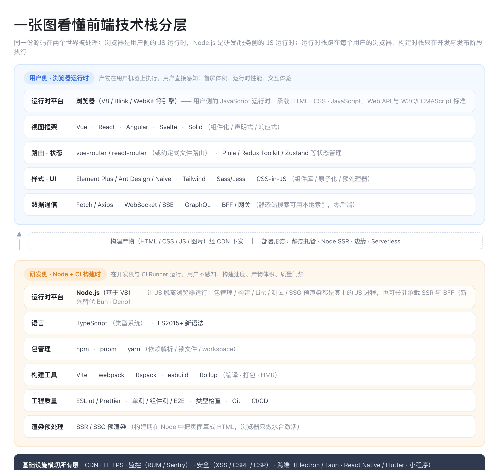

# 前端技术栈全景总览

> 本篇是「前端」目录的**第一张地图**，回答四个问题：一个现代前端应用由哪些层组成、每层解决什么问题、主流选择有哪些、各自适用什么场景。先建立分层心智模型，再按图索骥进入各分层专题。
>
> 阅读建议：零基础同学先读「一、二、三」建立全局观，再挑一个视图框架深入；有经验的同学可直接看「四、五」的选型对比与「八」的学习路径。

**前置依赖**：无，本篇本身就是前端部分的起点。

**事实基线**：本篇只做"分层与职责"层面的描述，工具会换、层次与要解决的问题长期稳定，因此除必要处外不逐一钉版本。

---

## 一、一张图看懂前端技术栈分层

现代前端可以沿"代码在哪里运行"切成两个世界：**用户侧（浏览器运行时）**与**研发侧（Node + CI 构建时）**，二者通过"构建产物 + 部署"衔接。

记住这张图的关键切分：**框架、路由、状态、UI、通信是"运行时栈"；Node.js 运行时、TS、包管理、构建、Lint、测试、预渲染是"构建时栈"**。很多困惑（为什么 SSG 站点不需要业务服务器、为什么语法高亮可以零运行时开销、为什么装工具前必须先装 Node.js）本质都是"某件事到底发生在哪个世界"。

## 二、分层总表：每层解决什么问题、主流选择有哪些

| 层 | 解决的核心问题 | 主流选择（代表性） |
| --- | --- | --- |
| 平台与标准 | 页面的三种原生语言与用户侧运行环境 | HTML/CSS/JS、ECMAScript(TC39)、W3C/WHATWG、浏览器引擎 V8/Blink/WebKit |
| 语言 | 大型项目的类型安全与新语法 | TypeScript、ES2015+ 语法 |
| 运行时（研发/服务侧） | 让 JavaScript 脱离浏览器、在机器上执行，承载整条工具链与服务端程序 | **Node.js**（基于 V8，事实标准）、Bun、Deno |
| 视图框架 | 组件化、声明式渲染、响应式更新 | Vue、React、Angular、Svelte、Solid |
| 路由 | URL 与页面/组件的映射 | vue-router、react-router、约定式文件路由 |
| 状态管理 | 跨组件共享状态、服务端数据缓存 | Pinia、Redux Toolkit、Zustand、Jotai、MobX、TanStack Query |
| 样式与 UI | 设计系统、响应式、主题 | 原生 CSS、Sass/Less、Tailwind、CSS-in-JS、Element Plus/Ant Design/Naive |
| 数据通信 | 取数、提交、实时推送 | Fetch、Axios、WebSocket、SSE、GraphQL、tRPC、BFF |
| 搜索 | 站内检索 | 本地索引（MiniSearch）、Algolia DocSearch、自建后端 |
| 包管理 | 依赖解析、锁版本、磁盘复用 | npm、pnpm、yarn |
| 构建工具 | dev server、编译、打包、HMR、资源处理 | Vite、webpack、Rspack、esbuild、Rollup、Parcel |
| 渲染范式 | 首屏速度、SEO、交互的权衡 | CSR、SSR、SSG、ISR、MPA、同构、岛屿架构 |
| 工程质量 | 风格统一、正确性、防回归 | ESLint、Prettier、Stylelint、Vitest/Jest、Playwright/Cypress、husky |
| 部署与基础设施 | 上线、分发、容灾 | CDN、GitHub Pages/Vercel/Netlify、Nginx、Node SSR、容器/K8s、Serverless |
| 性能与监控 | 度量、告警、持续优化 | Lighthouse、Core Web Vitals、Sentry、自建 RUM/APM |
| 安全 | 防注入、越权、传输安全 | XSS 防护、CSRF Token、CSP、CORS、HTTPS、依赖审计 |
| 跨端 | 一套能力触达多端 | Electron/Tauri（桌面）、React Native/Flutter、小程序/uni-app（移动端） |

读这张表的方法：**先看"解决什么问题"，再看"主流选择"**。工具会换，层次与要解决的问题长期稳定。

注意表里两个"运行时"的对称关系：**浏览器是用户侧的 JavaScript 运行时，Node.js 是研发侧（也可以是服务侧）的 JavaScript 运行时**，二者都用 V8 家族引擎、都跑 ECMAScript，这也是前后端"同构"成立的基础。

## 三、两条主线：运行时栈 vs 构建时栈

这是前端与传统后端最不一样的心智点——同一份源码会在两个完全不同的环境被处理。

| 对比项 | 浏览器运行时栈 | Node + CI 构建时栈 |
| --- | --- | --- |
| 在哪里跑 | 每个用户的浏览器（JS 运行时） | 开发者机器、CI Runner 上的 Node.js 进程（JS 运行时） |
| 典型成员 | 框架、路由、状态、UI 库、通信、Web API | Node.js 底座、TypeScript、包管理器、Vite/webpack、Lint、测试、SSR/SSG |
| 关心什么 | 首屏体积、运行时性能、兼容、交互体验 | 构建速度、产物体积、可复现、质量门禁 |
| 用户是否感知 | 直接感知（下载并执行的就是它） | 不感知，只拿到它产出的静态文件 |
| 出错表现 | 白屏、卡顿、hydration mismatch | 构建失败、CI 红灯、产物异常 |

两者的**交界处是同构渲染**：同一批组件在构建时（Node）跑 server bundle 预渲染出 HTML，再在浏览器（用户）跑 client bundle 水合激活，Nuxt、Next.js 等元框架的 SSR/SSG 都是这条"两阶段管线"。

### Node.js 在这张图里的位置

Node.js 容易被漏掉，是因为它不是与 Vite、webpack 并列的"某个工具"，而是**承载这些工具的运行时平台**——与"浏览器"对等的一层：

- **身份一：前端工具链的运行时底座（构建时）。** npm/pnpm/yarn 本身是 Node 程序；Vite、webpack、Rollup、ESLint、Prettier、Vitest/Jest、SSG 预渲染、dev server 全都跑在 Node 进程里。这也是为什么本机必须先安装 Node.js 才能 `npm install`、跑构建——没有这个底座，上面的工具链一行都跑不起来。
- **身份二：服务端 JavaScript 运行时（运行时）。** 需要服务器的场景里，Node 可以长驻承载 SSR 服务、BFF、API 网关（见第六、七节中"需要 Node 长驻"的部署形态）。此时它脱离了"前端工程化"语境，成为后端技术选型。
- 因为同样基于 V8、同样说 JavaScript，同一份组件代码才能在 Node（渲染成 HTML）和浏览器（水合交互）两边运行；Bun、Deno 是这个层级上的新兴替代运行时。

::: info
**一句话**：凡是"每个用户都要重复付出的成本"（渲染、高亮、建索引），尽量前移到构建时只做一次；凡是"必须因人而异/实时"的（登录态、交互、实时数据），才留在运行时。这也是内容型站点普遍选择 SSG 的根本原因。
:::

## 四、视图框架层：最重的一次技术选型

框架决定了组件模型、响应式机制与整个生态，是栈里迁移成本最高的决策，应先于具体库选择。

| 框架 | 模板/UI 写法 | 响应式与渲染机制 | 生态与适用 |
| --- | --- | --- | --- |
| Vue | SFC（template + script + style） | 基于 Proxy 的细粒度响应式 + 虚拟 DOM，编译期做静态优化 | 渐进式、中文社区强、文档/中后台应用广 |
| React | JSX（一切皆 JS） | 不可变状态 + 重新渲染，运行时调度（Concurrent） | 生态最大、招聘面广、大型复杂应用 |
| Angular | 模板 + 依赖注入 | 框架大而全（路由/表单/CLI 内置），响应式用 RxJS | 强约束、企业级大团队、TypeScript 优先 |
| Svelte | `.svelte` 单文件 | 编译期把响应式编译成命令式 DOM 操作，**无运行时库** | 极小产物、低运行时开销、个人/中小型项目 |
| Solid | JSX | 细粒度信号（Signal），不做整体 VDOM diff | 追求极致运行时性能、信号范式 |

选型维度按权重通常是：**团队既有技术栈 > 长期维护与生态 > 招聘供给 > 运行时性能/体积**。文档/内容站这类"框架由 SSG/元框架替你选好"的场景，跟着所选方案的技术栈走即可（如 Vue 生态的 VitePress/Nuxt、React 生态的 Docusaurus/Next.js），不必单独纠结框架。

**元框架（Meta-framework）** 在视图框架之上再封装"路由 + 数据获取 + 多种渲染范式 + 部署约定"：Vue 生态的 Nuxt、React 生态的 Next.js、Svelte 生态的 SvelteKit，以及内容站取向的 Astro。VitePress 则属于"专注内容型 SSG 的轻量元框架"——不做通用应用的那些能力（鉴权、服务端数据聚合），刻意收敛到文档场景。

## 五、构建与工程化层：为什么需要"构建"这一步

浏览器不能直接、也不应该直接消费我们写的工程化源码，构建环节负责把"对人友好的源码"变成"对浏览器与网络友好的产物"。这一整层工具（包管理器、构建器、Lint、测试、预渲染）都运行在 Node.js 这个底座之上（定位见第三节）。

- **为什么需要构建**：模块化打包（成百上千模块合成少量文件）、TS/JSX/Vue 编译、样式与图片等资源处理、按目标浏览器降级语法、tree-shaking、压缩与代码分割、开发期热更新（HMR）。
- **打包工具演进**：webpack（插件生态最全、配置复杂）→ esbuild（用 Go 写、极速、主打转译）→ **Vite**（开发期基于浏览器原生 ESM 按需编译、生产用 Rollup，冷启动快）→ Rspack（用 Rust 写、兼容 webpack 生态）/Turbopack 等。主线是"用 Go/Rust 等系统语言重写性能瓶颈 + 开发期利用原生 ESM"。
- **包管理器**：npm/yarn/pnpm 都管依赖与锁文件；pnpm 用硬链接与严格的非扁平 `node_modules` 节省磁盘并避免幽灵依赖，monorepo 体验更好。
- **质量门禁**：ESLint 管代码正确性与风格、Prettier 管格式、`tsc` 管类型、单测/组件测/E2E 管行为，统一在 CI 上作为合入门禁。
- **Monorepo**：多个包放一个仓库共享依赖与工具链，配合 pnpm workspace、Nx、Turborepo 做任务编排与增量缓存；单包小项目用不到这层。

实际项目里这些能力通常被脚手架或元框架封装为少量命令（开发 `dev`、构建 `build`、预览 `preview`），配置再按需透传给底层打包工具。理解封装之下 Vite/webpack 在做什么、跑在什么运行时上，才能在构建报错、产物异常时定位到正确的层。

## 六、数据通信与服务端协作

前端很少孤立存在，需要明确"数据从哪来、怎么推、谁聚合"。

| 方式 | 形态 | 典型场景 |
| --- | --- | --- |
| HTTP + REST | 请求/响应、JSON | 绝大多数 CRUD 接口；用 Fetch 或 Axios 调用 |
| WebSocket | 全双工长连接 | 聊天、协作编辑、实时行情 |
| SSE | 服务端单向推送 | 通知、日志流、AI 流式输出 |
| GraphQL | 客户端按需取字段 | 多端、字段聚合复杂的中大型应用 |
| BFF / 网关 | 专为前端聚合的后端层 | 一个页面需要多个后端服务拼装、做鉴权与裁剪 |

协作约定上：接口契约用 OpenAPI/Swagger 对齐，跨域靠 CORS，鉴权常用 Cookie + 会话或 Token（JWT 等），前后端职责边界由 BFF 收敛。纯静态内容站通常没有这层实时数据；搜索这类看似"需要后端"的能力也可以用构建期索引 + 浏览器本地检索替代，需要评论/表单时再接第三方 API 或 Serverless。

## 七、渲染范式与部署形态：决定首屏、SEO 与成本

把"页面 HTML 在什么时刻生成"与"部署在哪"对应起来，就串起了整个架构选型：

| 渲染范式 | HTML 生成时刻 | 首屏/SEO | 服务器 | 部署形态 |
| --- | --- | --- | --- | --- |
| CSR（客户端渲染） | 浏览器执行 JS 后 | 白屏、SEO 弱 | 仅静态托管 | 纯 CDN |
| SSR（服务端渲染） | 每次请求实时渲染 | 快、好 | 需要 Node 长驻 | Node 服务 + 容器/PM2 |
| SSG | 构建发布时预渲染 | 极快、好 | 不需要 | 纯静态 CDN / GitHub Pages 等托管 |
| ISR（增量静态再生成） | 构建 + 按需再生成 | 快、好 | 需要少量服务端能力 | 支持 ISR 的托管平台 |
| MPA（传统多页） | 服务端套模板 | 取决于后端 | 需要应用服务器 | Nginx + 应用 + 数据库 |

选型本质是按"读写比与时效性"匹配：读多写少、发布才变的内容（文档/博客/手册）→ SSG；强登录态/千人千面 → SSR/CSR；秒级实时数据 → CSR + 实时通信。

## 八、前端知识体系如何展开（学习路径）

建议按"**总览 → 地基 → 主干 → 工程化 → 架构与专项**"的顺序展开：先有这张全景地图，再逐层下钻。

| 全景中的层 | 对应知识模块 | 建议阶段 |
| --- | --- | --- |
| 平台与标准 + 语言 | JavaScript、TypeScript、浏览器原理（DOM/事件循环/渲染管线） | 地基：最先补 |
| 运行时（两侧） | 浏览器机制 + Node.js（工具链底座 / 服务端 JS） | 地基：与上同步 |
| 视图框架 + 路由 + 状态 | Vue 或 React 择一深入、客户端路由、Pinia/Redux 等 | 主干：选型后深耕 |
| 数据通信 | HTTP/REST、WebSocket/SSE、GraphQL、BFF 协作 | 主干：与框架并行 |
| 工程化 | 包管理、Vite/webpack、Lint/测试、Monorepo、CI/CD | 提效：做过项目后系统补 |
| 渲染范式 + 部署 | CSR/SSR/SSG/ISR、CDN、托管平台、容器/Serverless | 架构：建立全局权衡观 |
| 性能 / 安全 / 跨端 | Core Web Vitals、XSS/CSRF/CSP、Electron/RN/小程序 | 专项：按需深入 |

每个模块都可以沿用统一结构消化：定位（解决什么问题）→ 使用/配置 → 原理 → 工程与部署 → 实战场景 → 高频面试题。

## 九、高频面试：建立全景时常问的 9 题

1. **[高频] 全景题：从输入 URL 到页面可交互，前端各层如何协作？** DNS/网络取到 HTML → 解析构建 DOM/CSSOM → 下载并执行 JS bundle（构建时已由 Vite/webpack 打包、TS/Vue 已编译）→ 框架创建组件、路由匹配、取数（Fetch/BFF）→ 渲染并绑定事件（CSR 水合/SSG 直接激活）→ 异步资源与懒加载补齐。能按"网络 → 浏览器渲染 → 运行时框架 → 数据"四段说清即可。
2. **[高频] 辨析题：CSR/SSR/SSG 的区别与选型？** 区别在 HTML 生成时刻：CSR 在浏览器、SSR 每请求在服务器、SSG 构建时预渲染成文件。读多写少、发布才变的内容站选 SSG（免服务器、首屏快、SEO 好）；强登录态选 SSR/CSR。
3. **[高频] 原理题：为什么需要构建工具，Vite 为什么快，Node.js 在其中是什么角色？** 浏览器无法直接消费 TS/Vue/模块化与大量资源，构建负责编译、打包、tree-shaking、压缩与 HMR。Vite 开发期用浏览器原生 ESM 按需编译、用 esbuild 预构建依赖，冷启动不随项目变大变慢；生产用 Rollup 打包。这一整套工具链（npm、Vite、ESLint、测试、预渲染）都是运行在 **Node.js** 上的程序，Node 是构建时的 JS 运行时底座，不是与构建工具并列的工具。
4. **[高频] 辨析题：Vue 和 React 的核心差异？** Vue 用 SFC 模板 + Proxy 细粒度响应式，编译期做静态提升与补丁标记；React 用 JSX + 不可变状态驱动重渲染，靠运行时调度优化。写法、心智模型与生态不同，没有绝对优劣，按团队与场景选。
5. **[高频] 概念题：客户端路由 hash 和 history 模式区别？** hash 模式靠 `#` 后内容变化，不发请求、兼容性好但 URL 带 `#`；history 模式用 History API 得到干净 URL，但需要服务端/托管把未知路径回退到入口 HTML，否则刷新 404。SSG 站点则用预生成的 HTML 文件直接承载每条路由。
6. **[高频] 原理题：状态管理解决什么问题，状态何时该提升？** 解决跨组件/跨页面共享与状态一致性，避免层层透传 props。状态优先局部化（谁用谁持有），当多个无亲缘关系组件需要同一份可变数据、或需要持久化/调试时再提升到 Pinia/Redux；服务端数据缓存优先用 TanStack Query 这类专门工具而非塞进全局 store。
7. **[中频] 工程题：Monorepo 和多仓库怎么选？** Monorepo 便于多包共享依赖、统一工具链与原子提交、配合 workspace 做增量构建，适合强相关的多个包/组件库；多仓库隔离强、独立发布权限清晰，适合边界稳定、团队独立的产品。不要为"看起来先进"而上 Monorepo。
8. **[高频] 性能题：Core Web Vitals 是哪三个，怎么分层优化？** LCP（最大内容绘制，看首屏主体）、INP（交互到下一次绘制，看响应）、CLS（累积布局偏移，看稳定）。分层：构建期减小体积/路由分包/图片优化，传输层用 CDN 与压缩，运行时减少长任务与渲染次数，必要时用 SSG/预渲染直接消除首屏等待。
9. **[中频] 安全题：XSS 和 CSRF 是什么、前端怎么防？** XSS 是注入恶意脚本在用户浏览器执行，防御靠转义输出、不用不安全的 `v-html`/`innerHTML` 插入不可信内容、CSP 限制脚本源；CSRF 是冒用已登录身份发起请求，防御靠 CSRF Token、SameSite Cookie、校验来源。静态内容站攻击面小，但一旦接入评论/表单等动态能力就要重新评估。
