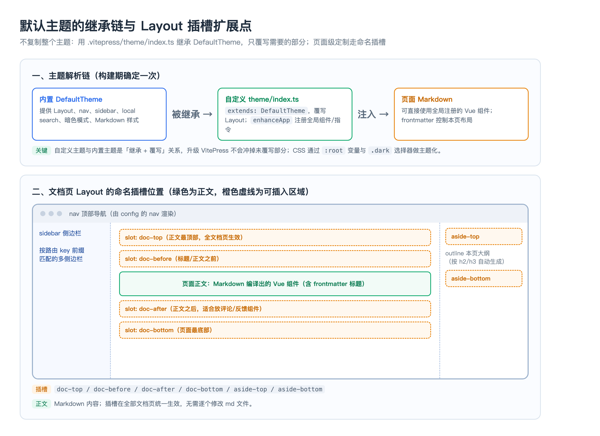

# 03 默认主题：导航、侧边栏、搜索与主题扩展

> 本页讲透默认主题（DefaultTheme）的可配置面与其背后的匹配机制：nav 分组、多侧边栏如何按路由命中、本地搜索为何不需要后端，以及如何通过继承与命名插槽扩展主题而不复制整个框架。
**前置依赖**：子模块 02（项目骨架、路由与 `config.mts`）
**适用版本**：VitePress `1.6.4`；默认主题配置项在 1.x 稳定，插槽名以 1.x 为准。
---
## 一、默认主题由什么组成
默认主题 = 一套内置的 Layout 布局组件 + 一份 `themeConfig` 约定。它直接提供顶部导航、左侧边栏、右侧大纲（outline）、上下篇、本地搜索、移动端菜单、深浅色切换、Markdown 排版与代码块样式。绝大多数站点只需写配置、不用写组件。配置都挂在 `themeConfig` 下：
```typescript
themeConfig: {
  nav: [/* 顶部导航 */],
  sidebar: { /* 按路由前缀映射的侧边栏 */ },
  outline: { level: [2, 3], label: '本页大纲' },
  search: { provider: 'local' },
  docFooter: { prev: '上一篇', next: '下一篇' },
  socialLinks: [{ icon: 'github', link: 'https://github.com/...' }]
}
```
## 二、nav：顶部导航与分组下拉
nav 是一个数组，项可以是单链接，也可以是带 `items` 的下拉。下拉项再嵌套一层 `items` 就形成「分组标题 + 三级链接」——分组标题只渲染为加粗不可点的标题：
```typescript
nav: [
  { text: '指南', link: '/guide/' },
  {
    text: '前端',
    items: [
      { text: 'VitePress', items: [
        { text: '快速开始', link: '/frontend/vitepress/01-ssg' },
        { text: '构建原理', link: '/frontend/vitepress/04-build' }
      ]}
    ]
  }
]
```
机制点：nav 的高亮不是靠精确匹配，而是按链接前缀推断当前归属；当一个一级菜单下有多个前缀相近的分区、默认高亮不准时，用 `activeMatch` 显式给一个正则（如 `activeMatch: '/frontend/'`）强制高亮。链接是 clean URL，不带 `.md`/`.html`。
## 三、sidebar：多侧边栏的前缀匹配机制
sidebar 不是一个数组，而是一个「路径前缀 → 侧边栏配置」的映射对象。这是默认主题里最需要理解的机制：
```typescript
sidebar: {
  '/basics/': [
    { text: 'Java 核心', collapsed: false, items: [
      { text: 'JVM', link: '/basics/java/jvm' }
    ]}
  ],
  '/frontend/vitepress/': [
    { text: 'VitePress', items: [/* … */] }
  ]
}
```
命中规则是**最长前缀匹配**：当前页面路径会与所有 key 比较，选择「能作为该路径前缀且最长」的那个侧边栏。因此：key 必须以 `/` 开头、以 `/` 结尾；`/frontend/vitepress/` 比 `/frontend/` 更长更具体，进入 VitePress 页面时会优先命中前者而不是笼统的前端侧边栏。分组对象用 `collapsed` 控制默认折叠；`items` 里的链接决定左侧条目，标题文字与文件 H1 是两处独立来源。
::: warning
**高频踩坑**：侧边栏链接的每个落点都必须有对应 md（且分区首页要有 `index.md`），否则构建期 dead link 直接失败；新增页面要同时「建文件 + 登记 nav/sidebar」，两者缺一不可。
:::
## 四、搜索：本地索引为什么不需要后端
配置 `search: { provider: 'local' }` 后，VitePress 在**构建期**扫描全部 Markdown，分词、提取标题与正文，生成压缩的 MiniSearch 索引（随静态产物分发）。用户输入时，浏览器加载该索引并用内置的 MiniSearch（`minisearch ^7`）在内存里匹配，请求不出本机，所以没有搜索服务器。可进一步配 `options.locales`、`miniSearch.options`（如 `_fuzzyLength`、字段权重）和 `exclude` 控制收录范围。
| 维度 | local（默认，MiniSearch） | Algolia DocSearch |
| --- | --- | --- |
| 索引生成 | 构建期本地生成 JSON | 由 Algolia 爬虫定期抓取生成 |
| 后端/账号 | 不需要 | 需要申请 DocSearch 或自付 Algolia |
| 适用规模 | 数百至数千页，索引体积可控 | 超大站点、多站聚合、需要高级排序 |
选型判断：个人/团队知识库用 local 完全够；页面过万导致索引 JSON 过大、首次加载索引变慢时，才需要换成 Algolia 这类服务端搜索。
## 五、主题扩展：继承 + enhanceApp + 命名插槽
需要默认主题没有的东西（自定义组件、评论区、全局样式）时，在 `.vitepress/theme/index.ts` 扩展，而不是拷贝整个默认主题源码：
```typescript
import DefaultTheme from 'vitepress/theme'
import type { Theme } from 'vitepress'
import MyBadge from './components/MyBadge.vue'
import './custom.css'

export default {
  extends: DefaultTheme,
  enhanceApp({ app }) {
    app.component('MyBadge', MyBadge)   // 注册后任意 md 可直接 <MyBadge />
  }
} satisfies Theme
```
`extends` 表示继承默认主题的全部能力，只覆写你提供的部分，升级 VitePress 不会冲掉未覆写能力；`enhanceApp` 拿到 Vue app 实例，可注册全局组件、指令、插件。更细粒度的页面级定制走 Layout 的命名插槽：
```javascript
<script setup lang="ts">
import DefaultTheme from 'vitepress/theme'
const { Layout } = DefaultTheme
</script>
<template>
  <Layout>
    <template #doc-after><CommentSection /></template>
    <template #aside-top><SponsorCard /></template>
  </Layout>
</template>
```

## 六、样式定制：CSS 变量与暗色模式
默认主题用一组 CSS 自定义属性（如 `--vp-c-brand-1`、`--vp-layout-max-width`）驱动配色与版式。覆盖方式是在自定义 CSS 里改 `:root`（浅色）与 `.dark`（深色）下的变量，或用更具体的选择器覆盖类名。暗色切换是默认内置的，切换时给 `<html>` 加 `.dark` 类，因此自定义图片要做两套时可用 VitePress 提供的 `light-only` / `dark-only` 类随主题显隐。不要去改 `node_modules` 里的主题源码——升级即丢，正确路径永远是 theme 目录 + CSS 变量。
## 七、实战场景
### 场景 1：一级菜单需要「二级分组 + 三级页面」的下拉
实现：nav 项用两层嵌套，外层 `items` 元素形如 `{ text: '分组名', items: [...] }`，分组名渲染为加粗标题、内层才是可点链接。排查：若分组名变成可点坏链，多半是在分组对象上误加了 `link`，分组对象只应包含 `text` 与内层 `items`。
### 场景 2：进入子分区却高亮/显示了错误分区的侧边栏
根因：侧边栏 key 前缀重叠，命中了更粗的 `/frontend/` 而非 `/frontend/vitepress/`，或 key 漏了结尾 `/`。修复：补全 `/` 并为具体子分区提供更长 key，依靠最长前缀匹配收口；必要时用 nav 的 `activeMatch` 修正顶部高亮。
### 场景 3：要在所有文档底部统一加评论，又不想改每个 md
用主题扩展：在 `theme/index.ts` 继承默认主题，把评论组件放进 Layout 的 `doc-after` 插槽，一处生效全站；评论数据接 Giscus（GitHub Discussions），仍然零自有后端。注意评论组件若访问 `window`，需放在客户端挂载后逻辑，避免与服务端预渲染冲突（见子模块 04 水合）。
## 八、关键问题思考
1. **[高频] 原理题：多侧边栏是怎么决定当前页显示哪一条的？** sidebar 是「路径前缀 → 配置」的映射对象，对当前 URL 做最长前缀匹配，选中以 `/` 起止、且作为该路径前缀的最长 key。所以 key 要带首尾斜杠，具体子分区用更长的 key 覆盖笼统分区。
2. **[高频] 配置题：nav 如何实现二级分组、三级链接？** 用嵌套 items：一级菜单的 items 里放 `{ text: 分组, items: [链接…] }`，分组 text 渲染为加粗不可点标题，内层 items 才是页面链接；不要给分组对象加 `link`。
3. **[高频] 原理题：本地搜索为什么不需要后端？** 索引在构建期扫描 Markdown 生成 MiniSearch 压缩 JSON 随静态资源下发，检索在浏览器内存中完成，没有查询请求，因此不需要搜索服务器。
4. **[高频] 辨析题：local 搜索与 Algolia DocSearch 怎么选？** local 零配置零成本、索引本地生成，适合数百到数千页；Algolia 靠外部爬虫与服务端索引，适合超大站点或多站聚合、需要高级排序，但要申请或付费。以索引体积与首载成本为拐点。
5. **[中频] 原理题：`extends: DefaultTheme` 的意义是什么？** 它表示自定义主题继承默认主题全部布局与能力，只覆写显式提供的部分；相比拷贝主题源码，升级 VitePress 时未覆写部分自动获得更新，维护成本低。
6. **[高频] 机制题：`enhanceApp` 能做什么？** 它是主题级的 Vue app 钩子，拿到 app 实例后可注册全局组件、指令、插件；注册的全局组件可在任意 Markdown 中直接使用，是「Markdown 里用 Vue」的主要入口。
7. **[高频] 概念题：要在所有页面同一位置插入一块内容，怎么办？** 用 Layout 命名插槽（如 `doc-top`/`doc-after`/`aside-top`），在自定义主题里一次性注入，避免逐页编辑 Markdown。
8. **[中频] 场景题：新增一个页面后左侧栏/构建为什么出问题？** 常见是只建了文件没登记 sidebar，或登记了链接但文件缺失/分区缺 `index.md`，后者会被构建期 dead link 拦截。规范动作是「建 md + 登记 nav/sidebar」成对完成，路径大小写完全一致。
9. **[中频] 原理题：暗色模式和品牌色怎么定制才不会被升级冲掉？** 在 `theme/custom.css` 中覆盖 `:root` 与 `.dark` 下的 `--vp-c-*` 等 CSS 变量，在 `theme/index.ts` 引入；不要修改 `node_modules` 内主题源码。自定义图片可用 `light-only`/`dark-only` 类随主题切换。
