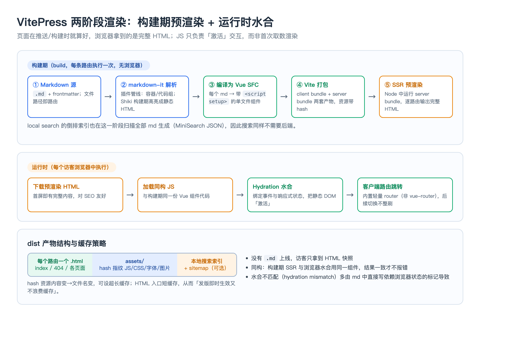

# 04 构建原理：从 Markdown 到静态产物

> 本页是全树机制最硬的一章，回答四个「为什么」：Markdown 怎么变成页面、代码高亮为什么不依赖运行时、VitePress 为什么能先给完整 HTML 再水合、以及构建产物到底长什么样。理解了这条管线，自定义容器、接入插件、排查水合问题才有抓手。
**前置依赖**：子模块 02（骨架与配置）、子模块 03（主题）
**适用版本**：VitePress `1.6.4`，内置 `vite ^5.4`、`vue ^3.5`、`shiki ^2`、`minisearch ^7`。
---
## 一、两阶段管线总览
整条链路分构建期与运行时，二者运行**同一份** Vue 组件代码（同构），这是水合不报错的前提。

构建期（`vitepress build`，无浏览器）：Markdown → markdown-it 解析为 token → 编译为 Vue 单文件组件 → Vite 分别打包出 client bundle 与 server bundle → 在 Node 中用 server bundle 对每条路由做 SSR 预渲染，输出完整 HTML。运行时：浏览器下载预渲染 HTML 与 client bundle，执行水合（hydration）绑定事件与响应式状态，之后跳转走内置路由器。
## 二、markdown-it：token 管线与扩展入口
Markdown 不是被正则直接替换成 HTML，而是先经 markdown-it 解析成一棵 token 语法树，再由渲染规则输出 HTML。VitePress 在这棵树上挂了多层能力：frontmatter 提取、标题 slug 与大纲、链接重写（加 `base`）、代码块增强、自定义容器（`::: info`）、代码组（`::: code-group`）、行高亮标记等。需要自定义语法时，通过配置的 `markdown.config(md)` 拿到 markdown-it 实例，按 `md.use(plugin)` 接入插件或加渲染规则：
```typescript
export default defineConfig({
  markdown: {
    lineNumbers: true,
    config(md) {
      // md.use(某个 markdown-it 插件)；在 token→HTML 层做定制
    }
  }
})
```
要点：扩展发生在**解析/渲染层**，产出的仍是标准 Vue 模板片段，所以插件能力能和后续 Vue 编译无缝衔接。
## 三、Shiki：为什么代码高亮不依赖运行时
代码高亮由内置 Shiki（`shiki ^2`）完成，但它在**构建期**就跑：用与 VS Code 同源的 TextMate 语法把代码 tokenize 成带主题色 class/style 的静态 HTML，直接写进产物页面。浏览器加载时看到的是已经上好色的 `<span>`，不需要下载高亮引擎、不需要 JS 执行后才变色。这带来两个结果：一是高亮结果对爬虫可见、零运行时开销、不闪烁；二是主题与语言在构建期决定，可用 `markdown.theme`（支持浅色/深色双主题）与 `themeConfig` 控制，换主题要重新构建。
## 四、每个 md 被编译成一个 Vue SFC
这是 VitePress「Markdown 里能写 Vue」的根因。一个 md 在构建中大致变成这样的单文件组件：模板部分是 markdown-it 渲染出的 HTML，外加一个 `script setup` 暴露本页数据：
```javascript
<template>
  <!-- markdown-it 输出的内容，含高亮后的代码块、容器 -->
</template>

<script setup>
const { frontmatter, title, headers, ... } = useData()
// frontmatter 即本页 --- 之间的数据；headers 供大纲使用
</script>
```
页面中可直接用 `$frontmatter` 或 `useData()` 读取本页元数据，也可以直接写 Vue 模板与导入组件。因为每页就是标准 SFC，它天然享受 Vite 的 HMR：dev 下保存 md 只重编当前页，热更新极快。
## 五、Vite 双 bundle 与 SSR 预渲染
VitePress 让 Vite 打两套包：client bundle 是给浏览器做水合与交互的 JS（按路由分包、资源带内容 hash）；server bundle 是在 Node 里运行的同构渲染入口。构建时 VitePress 遍历全部路由，对每条路由执行一次服务端渲染，把组件树序列化成 HTML 字符串写入对应 `.html`。这与「SSR」用的是同一套服务端渲染能力，区别只是时机：SSR 每请求渲染，SSG 把结果在构建时固化成文件。这也是为什么页面源码里已经有完整正文，而不是空挂载点。
## 六、运行时：内置路由器与水合（注意不是 vue-router）
一个常见误解需要纠正：**VitePress 没有使用 vue-router**，它自带一个为静态站定制的轻量路由器。首次进入是完整文档加载；之后点击站内链接，路由器拦截跳转，按需拉取目标页的 JS 分片并在客户端切换组件、更新标题与滚动位置，不整刷，形成类似 SPA 的体验，但首屏始终来自预渲染 HTML。水合阶段，Vue 用 client bundle 在现有 DOM 上重建组件实例并绑定事件，而不是重新渲染一遍替换 DOM；当服务端产出的 HTML 与客户端首次渲染结果不一致时会报 hydration mismatch。常见诱因是在模板中直接渲染依赖浏览器且 SSR/CSR 结果不同的值（如直接内联 `Date.now()`、`Math.random()`、`window` 尺寸），正确做法是放进 `onMounted` 后再读取，或用 `<ClientOnly>` 包裹。
## 七、构建产物结构
产物目录默认 `.vitepress/dist`：每个路由一个 HTML 文件（含 `index.html` 与 `404.html`），`assets/` 放带内容 hash 的 JS/CSS/字体/图片，本地搜索索引、可选的 sitemap 也在其中。文件名带 hash 意味着「内容变 → 文件名变」，配合部署侧给 hash 资源长缓存、给 HTML 短缓存，可同时做到发版即时生效与缓存高命中（部署细节见子模块 05）。开启 `sitemap.hostname` 后构建会产出站点地图供搜索引擎收录。
## 八、实战场景
### 场景 1：接入自定义 Markdown 语法/容器后不生效或与 Vue 冲突
定位：先判断需求属于「解析期」还是「运行期」。新语法块（如提示块、折叠面板）应在 `markdown.config` 用 markdown-it 规则或 `:::` 容器实现，产出合法 Vue 模板；需要交互状态才升级为 Vue 组件。冲突多因自定义规则输出了未转义的 `<`/`>` 或大括号被 Vue 当模板解析，转义或改用容器即可。
### 场景 2：控制台出现 hydration mismatch
排查：找页面中在服务端与客户端首次渲染结果可能不同的表达式——随机数、当前时间、`window`/`localStorage` 直读、SSR 不支持的组件。治理：把读取浏览器状态推迟到 `onMounted`，纯客户端组件用 `<ClientOnly>` 包裹；修后本地用 `vitepress build` + `vitepress preview` 复现，dev 模式不做完整 SSR，不能替代。
### 场景 3：大站点构建变慢、搜索索引首载偏大
机制与治理：构建成本主要在逐路由 SSR 与 Shiki 高亮、搜索索引生成。用 `cache` 保留增量缓存、CI 缓存依赖与 `.vitepress/cache`；用 `search.options.exclude` 排除目录、调 MiniSearch 字段与分词缩小索引；代码高亮语言按需引入；页面过万再考虑 Algolia。
## 九、关键问题思考
1. **[高频] 原理题：一个 Markdown 文件经历了哪些阶段才成为页面？** markdown-it 解析为 token 树（含 frontmatter、标题、容器、代码增强）→ 编译为 Vue 单文件组件 → Vite 打包 client/server 双 bundle → Node 中 server bundle 逐路由 SSR 预渲染出 HTML；浏览器再用 client bundle 水合。
2. **[高频] 辨析题：VitePress 的 SSG 和普通 SSR 用的是同一套渲染吗？** 服务端渲染能力相同，差别在时机与产物：SSR 在每次请求时实时渲染、需要常驻服务器；SSG 在构建时对每条路由渲染一次并固化为 HTML 文件，之后由 CDN 直接返回。
3. **[高频] 原理题：为什么 Markdown 里可以直接写 Vue 组件？** 每个 md 在构建期被编译成标准 Vue SFC：markdown-it 输出作为模板，`script setup` 暴露 `useData()`/`frontmatter`，因此模板里能使用任意注册过的组件与 Vue 语法。
4. **[高频] 机制题：VitePress 用的是 vue-router 吗？** 不是。它内置一个为静态站定制的轻量路由器：首屏走预渲染文档，站内跳转时按需拉取目标页分片并客户端切换，不整刷，不需要 vue-router。
5. **[高频] 原理题：代码高亮在什么时候完成，有什么好处？** 由 Shiki 在构建期用 TextMate 语法把代码转成带颜色的静态 HTML；运行时零开销、不闪烁、高亮内容对 SEO 可见，也不必下发高亮库。
6. **[高频] 机制题：什么是水合，hydration mismatch 怎么来的？** 水合是 Vue 用 client bundle 在已有静态 DOM 上重建组件实例、绑定事件与响应式状态的过程。当服务端 HTML 与客户端首次渲染结果不一致（如内联随机数、时间、`window` 值）就会 mismatch；应把这类读取放进 `onMounted` 或用 `<ClientOnly>`。
7. **[中频] 原理题：client bundle 与 server bundle 为什么是两套？** 运行环境不同：server bundle 在 Node 执行、产出 HTML 字符串；client bundle 在浏览器执行、负责水合与交互。二者由同一批组件源码生成（同构），分工明确且结果需一致。
8. **[高频] 概念题：为什么首屏对 SEO 友好，跳转又能像 SPA？** 首屏 HTML 在构建期已含完整正文，爬虫与首访直接读到内容；水合后后续导航由内置路由器在客户端无刷新切换，兼顾了可抓取性与 App 式体验。
9. **[中频] 场景题：资源文件名为什么要带 hash，和缓存什么关系？** 内容变才会改变 hash 文件名，因此 hash 资源可设超长强缓存，HTML 入口设短缓存；发版后 HTML 引用新 hash，用户即时拿到新版本，未变资源继续命中缓存。
