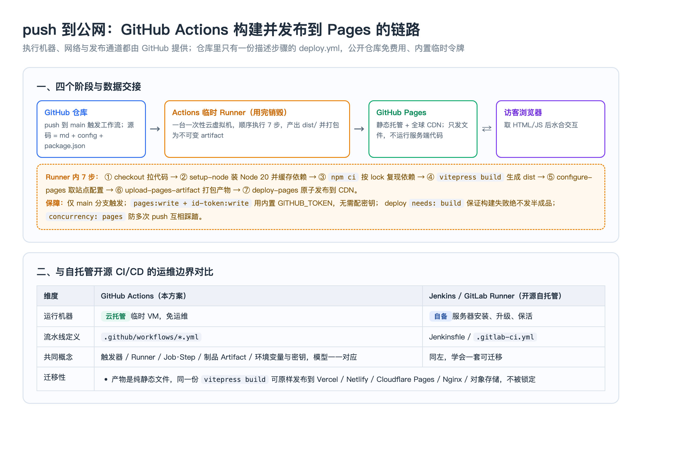

# 05 部署与 CI/CD：GitHub Pages 与自动发布

> 本页讲清楚静态站的部署目标选型、GitHub Pages 到底提供什么、如何用一条 Actions 流水线把 push 变成公网更新，以及缓存/自定义域名等上线后真正会遇到的问题。
**前置依赖**：子模块 02（`base`）、子模块 04（产物结构）
**适用版本**：VitePress `1.6.4`；GitHub Pages 与官方 Actions 动作 `configure-pages`/`upload-pages-artifact`/`deploy-pages` v1（workflow 中可用 v5/v1 组合），平台能力以 GitHub 官方文档为准。
---
## 一、部署目标矩阵
静态产物可以放在任何能发文件的地方，选型主要看是否要免运维、是否需自定义域名、团队网络环境：
| 平台 | 形态 | 构建/CI | 成本与备注 |
| --- | --- | --- | --- |
| GitHub Pages | 静态托管 + 全球 CDN | 配 GitHub Actions | 公开仓库免费；`*.github.io` 免备案 |
| GitLab Pages | 静态托管 | `.gitlab-ci.yml` | 概念与 Pages 几乎一致 |
| Vercel / Netlify / Cloudflare Pages | 静态/JAMStack 托管 + CDN | 连仓库自动构建，预览环境开箱即用 | 免费额度充足，私有仓库也能免费用 |
| 自建 Nginx / 对象存储 | 静态文件服务器 | 自己接 Jenkins/GitLab Runner 上传 | 可控但要自己运维与配 HTTPS |
## 二、GitHub Pages 是什么，以及两种站点形式
GitHub Pages 是 GitHub 官方的**静态网页托管服务**，本质是挂在全球 CDN 上的静态文件出口：接收 HTTPS 请求、返回 HTML/CSS/JS、自动签发与续期 HTTPS 证书。关键边界是它**不能运行服务端代码**（Java/Node/PHP 都不行），也连不了数据库——这与 SSG 恰好匹配。它有两种形式，直接决定 `base`：
| 类型 | URL | base |
| --- | --- | --- |
| 用户/组织站点 | `用户名.github.io/` | `/` |
| 项目站点（本站） | `用户名.github.io/仓库名/` | `/仓库名/` |
公开仓库免费额度对个人知识库绰绰有余（站点存储约 1GB、软限月流量约 100GB）。使用 Actions 构建时，分钟数由 Actions 额度承担，Pages 只接收最终产物。
## 三、用 GitHub Actions 把 push 变成公网更新
自动构建/发布能力来自 GitHub 官方云服务 **GitHub Actions**；仓库里只有一份描述步骤的 YAML，机器、网络、发布通道都由 GitHub 提供，用仓库内置临时令牌鉴权，无需配置密码。

一条最小可用流水线的关键步骤如下（`on.push.branches: main` 触发）：
```yaml
name: Deploy VitePress site to Pages
on:
  push:
    branches: [main]
permissions:
  contents: read
  pages: write
  id-token: write
jobs:
  build:
    runs-on: ubuntu-latest
    steps:
      - uses: actions/checkout@v4
      - uses: actions/setup-node@v4
        with:
          node-version: 20
          cache: npm
      - run: npm ci
      - run: npm run docs:build
      - uses: actions/configure-pages@v5
      - uses: actions/upload-pages-artifact@v3
        with:
          path: ./docs/.vitepress/dist
  deploy:
    needs: build
    runs-on: ubuntu-latest
    environment:
      name: github-pages
      url: ${{ steps.deployment.outputs.page_url }}
    steps:
      - id: deployment
        uses: actions/deploy-pages@v4
```
七个动作的职责依次是：checkout 拉代码 → setup-node 装 Node 并缓存依赖 → `npm ci` 按 lock 文件可复现安装 → `vitepress build` 生成 dist → configure-pages 读取 Pages 配置 → upload-pages-artifact 把 dist 打包为不可变产物 → deploy-pages 原子发布到 CDN。仓库 Settings → Pages 的 Source 必须选为 **GitHub Actions**，否则 configure-pages 会失败。
## 四、权限、原子发布与并发
- **令牌**：`pages: write` + `id-token: write` 使用每次运行自动生成的 `GITHUB_TOKEN`，不存任何长期密钥。
- **原子性**：deploy 作业 `needs: build`，构建失败就不会进入发布，线上不会出现半成品；一次部署对应一个不可变 artifact。
- **并发控制**：用 `concurrency: { group: pages, cancel-in-progress: true }`，连续多次 push 时取消旧的进行中部署，避免互相踩踏与重复发布。
- **触发范围**：只有 main 分支触发发布；在功能分支上改动不影响线上，适合 PR 评审。
## 五、为什么 push 后约一分钟就能看到更新
push 触发流水线 → 构建出新的 hash 资源与 HTML → 部署替换 CDN 内容。配合子模块 04 的产物命名：hash 资源内容变文件名才变、可长期强缓存，HTML 入口短缓存，因此新版本入口 HTML 一旦更新就会引用新 hash，用户刷新即得新版，未改动资源继续命中缓存。若仍看到旧内容，多为浏览器/CDN 对 HTML 的缓存，强刷或等待缓存过期即可。
## 六、迁移到其它平台不被锁定
整个方案里只有「执行环境与出口」是 GitHub 闭源的；构建工具 VitePress 开源、源码与流水线剧本都在自己仓库。同一份 `vitepress build` 产物可以原样部署：Vercel/Netlify/Cloudflare Pages 连接仓库后把构建命令设为 `vitepress build`、输出目录设为 `docs/.vitepress/dist` 即可；自建环境则把 dist 交给 Nginx 静态托管。注意**根域名部署时把 `base` 改回 `/`**。
## 七、自定义域名
购买域名 → 在 Settings → Pages 的 Custom domain 绑定并在 DNS 服务商处配置 CNAME/解析指向 Pages → 勾上 Enforce HTTPS → 因站点变为根域名，把 `base` 改回 `/` 后重新发布。自定义域名通过 HTTP→HTTPS 与证书自动签发收敛，其余自动发布链路不变。
## 八、实战场景
### 场景 1：首次推送后 Actions 在 configure-pages 步骤失败
根因不是代码，而是仓库从未开启 Pages 或 Source 选错。修复：Settings → Pages → Source 选 **GitHub Actions**（不是 Deploy from a branch），再重跑流水线或推一个空提交触发。
### 场景 2：页面 200 但样式与 JS 404（裸页）
根因是项目站点仍用默认 `base: '/'`。修复：设 `base: '/仓库名/'`（首尾斜杠），重新构建发布；在 DevTools Network 确认资源路径已带仓库名前缀。
### 场景 3：连续推送后线上状态对不上某次提交
根因：多个部署并发、旧部署后完成覆盖新部署。修复：加 `concurrency: pages` 并设 `cancel-in-progress: true`，只保留最新一次发布；排查时以 Actions 中 Deployments 的提交号与时间为准。
## 九、关键问题思考
1. **[高频] 概念题：GitHub Pages 到底是什么、不能做什么？** 它是 GitHub 提供的静态网页托管服务，即挂在 CDN 上的静态文件出口，负责发文件与 HTTPS；不能运行服务端代码、不能连数据库。正适合 SSG 这种运行期零计算的站点。
2. **[高频] 原理题：push 之后网站为什么会自动更新？** 推送 main 触发 GitHub Actions 工作流，临时 Runner 依次完成拉代码、装依赖、`vitepress build`、打包并 deploy 到 Pages；发布通道与临时令牌都由 GitHub 提供，无需自己的服务器。
3. **[高频] 辨析题：GitHub Actions 和 Jenkins 是什么关系？** 二者是同类 CI/CD，都有触发器、Runner、Job/Step、制品这些概念；区别是 Actions 的 Runner 由 GitHub 云托管免运维，Jenkins 需自备服务器安装维护。流程模型可互相迁移，但 YAML 写法不通用。
4. **[高频] 配置题：Pages 的 Source 为什么要选 GitHub Actions？** 选择 GitHub Actions 表示 Pages 只接收流水线上传的构建产物；未开启或选成分支部署时，`configure-pages` 取不到部署环境会失败，Deploy 作业被跳过。
5. **[高频] 机制题：为什么不用在仓库里存任何密钥？** 流水线用每次运行自动签发的 `GITHUB_TOKEN`，配合 `pages: write`、`id-token: write` 权限即可完成发布，令牌短期有效、作用于本仓库，无需长期凭据。
6. **[高频] 原理题：deploy 为什么要 `needs: build` 和 concurrency？** `needs: build` 保证只有构建成功才发布，杜绝半成品上线；concurrency 在连续推送时取消旧运行，防止旧部署覆盖新部署，二者共同保证发布的原子性与顺序正确。
7. **[中频] 场景题：项目站点上线后页面裸奔怎么查？** DevTools Network 看资源是否 404 且路径缺仓库名前缀，若是则把 `base` 设为 `/仓库名/` 重新发布；根域名/自定义域名场景则应是 `/`。
8. **[中频] 概念题：静态站为什么更新能即时生效又能大量缓存？** hash 资源文件名随内容变化、可强缓存，HTML 入口短缓存；发版后入口 HTML 引用新 hash 文件名，用户立即取到新资源，未变资源继续用缓存。
9. **[中频] 场景题：如何迁到 Vercel/Netlify 或 Nginx？** 构建命令用 `vitepress build`、发布目录指向 `docs/.vitepress/dist`；平台连仓库自动构建，Nginx 则上传 dist。根域名部署把 `base` 改回 `/`，项目子路径保留对应前缀。
